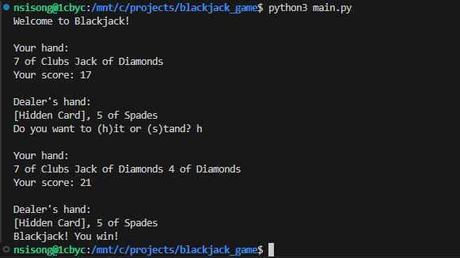

> **Licensing update (31 October 2026):** The current policy requires prior written permission for reuse and a separate agreement for AI training. See [LICENSE](LICENSE). Earlier grants remain valid for previously licensed material; [LICENSE.previous](LICENSE.previous) preserves those terms. Any older license descriptions below describe the previous policy. Contact [ei@nsisong.com](mailto:ei@nsisong.com).

# blackjack-game

i built this 3 years ago with C# but i think i need to change things this time. much efficient atleast.

## How to run this shii

1. install python.
2. then, run the following command:

```bash
python main.py
```

## by the way, this is how it looks when you run it:

